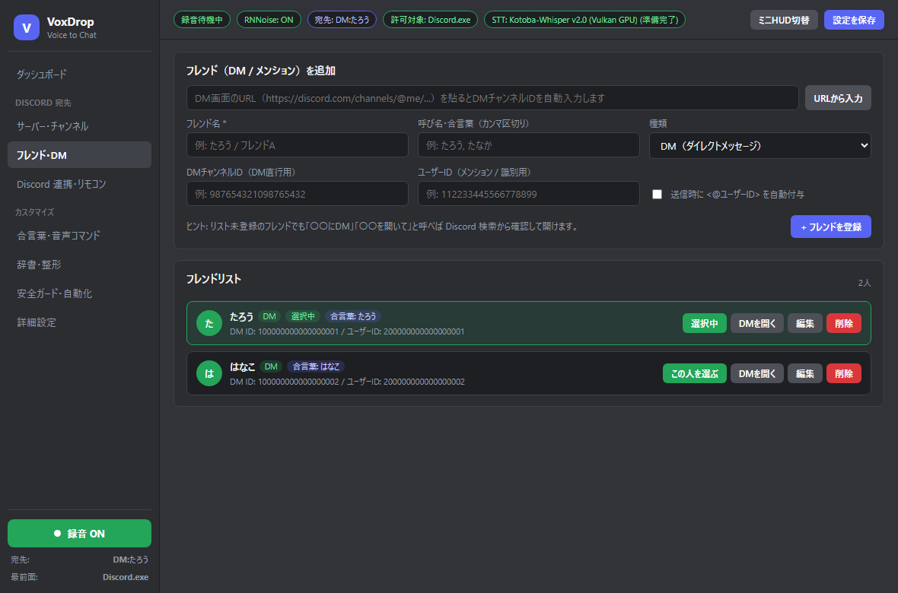
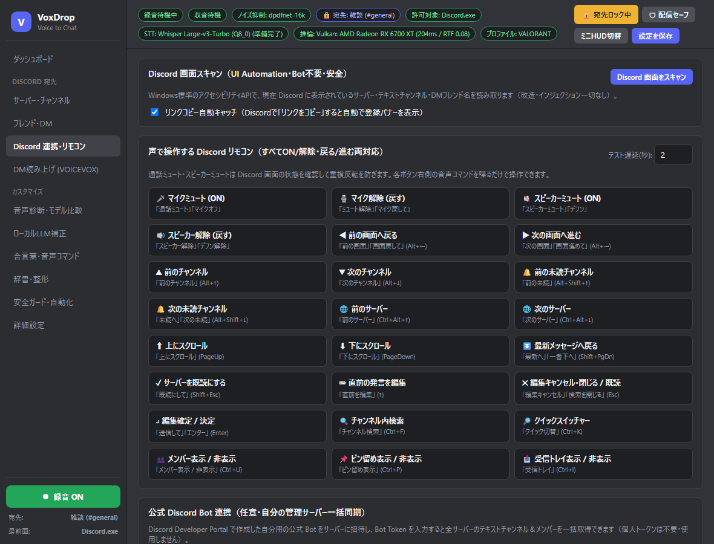
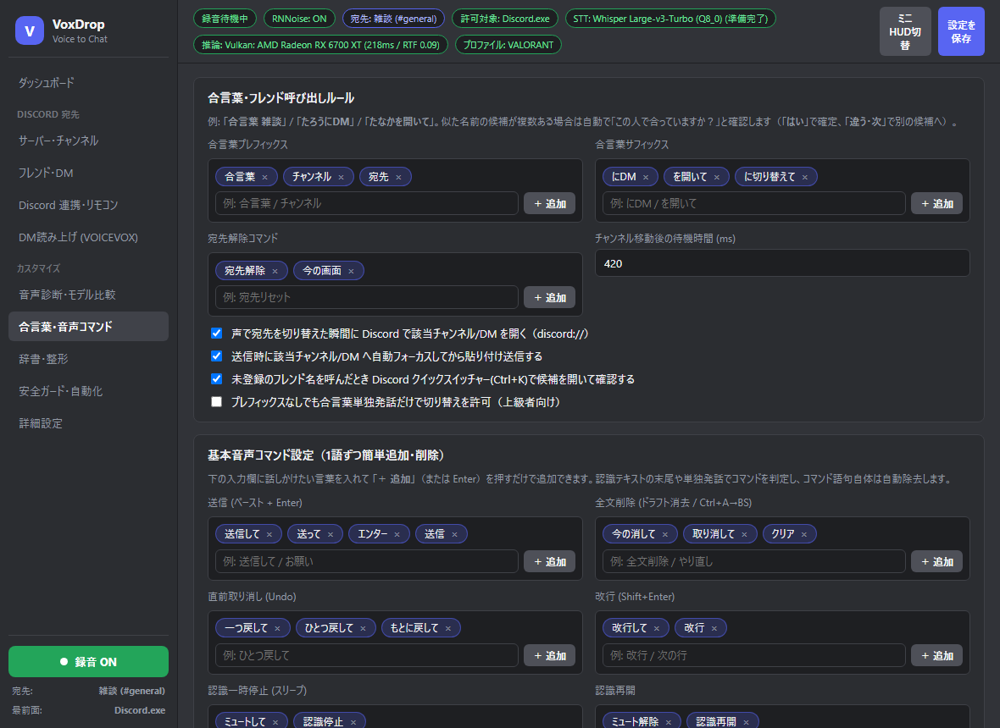

# VoxDrop — ハンズフリー日本語音声チャット支援アプリ（Discord 向け）

**VoxDrop** は、ゲームや作業をしながら **声だけで Discord のメッセージ入力・送信・宛先切替・リモコン操作** が完結する、Windows 向け超高速ローカル音声入力デスクトップアプリです。

すべて **ローカル推論（クラウド送信ゼロ・無料・オフライン動作）** ＆ **Windows 公式 API のみ（Discord 規約準拠・プロセス注入なし）** で安全に動作します。


---

## 主な特徴

### 1. Whisper Large-v3-Turbo (Q8) × Vulkan GPU 高速高精度認識
- **Whisper Large-v3-Turbo (Q8_0)**（詳細設定から **Kotoba-Whisper v2.0** 等への切替も可）＋**Vulkan GPU 加速（AMD / NVIDIA / Intel 対応・CPU 自動フォールバック）** を内蔵。
- **Dual-Path 音声パイプライン**: VAD 判定側には RNNoise 雑音抑制を適用しつつ、Whisper へ送る音声はノイズゲート無し・自然な音質を保つ専用経路を通すことで、ゆっくり発話・小声・通常会話・早口のすべてで誤認識や認識落ちを大幅に低減しました。
- **動的コンテキストヒント**: 登録した音声コマンド・カスタム辞書・フレンド／チャンネル名を Whisper の `initial_prompt` へ自動注入し、固有名詞や「送信して」等の認識率を高めます。
- 単一の **`voxdrop.exe`** にランタイム＆日本語モデル＆Silero VAD を丸ごと内蔵しているため、ダウンロードしてダブルクリックするだけですぐに使えます（多重起動防止にも対応）。

### 2. Silero VAD × 適応型ノイズ学習 ＋ 会話スタイルプリセット
- **Silero VAD (`silero_vad.onnx`) ＋ 適応型 SNR**: ニューラル音声区間検出と環境ノイズ床学習を組み合わせ、話し始めの小声やゆっくりした発話も取りこぼさず、無音や雑音は確実に除外します。
- **会話プリセット**: ダッシュボードから **「通常会話（推奨）」「早口・連続」「ゆっくり・小声」** をワンクリックで切り替え可能。
- **2 秒ノイズ自動測定ボタン** ＆ **RNNoise リアルタイムノイズ抑制** ＆ **2ch オーディオインターフェース（Steinberg UR22mkII 等）片チャンネル自動ゲイン最適化** を搭載。

### 3. 声だけで宛先切替 → DM を開いて入力欄へ自動フォーカス＆即送信
- **合言葉・フレンド名で切り替え**: 「合言葉 〇〇」「〇〇にDM」「〇〇に切り替えて」と話すだけで、Discord を自動で前面化し、プロフィール画面を経由する場合も「メッセージ」ボタンを自動クリックしてチャット入力欄へフォーカスします。
- **非ブロッキング複数候補の音声確認**: 似た名前のフレンドが複数いる場合もアプリ操作を止めずに確認バナーを表示し、「はい」「違う・次」「前の人」「キャンセル」と声だけで選べます。
- **バックグラウンド自動送信＆復帰**: ゲーム画面のまま「送信して」「送って」「エンター」と言うだけで、裏にある Discord へ約 0.15 秒で自動送信し、元のゲーム画面へフォーカスを戻します（Webhook 直接送信にも対応）。

### 4. 見やすい宛先管理 & ゲーム画面に重ねられる透過ミニ HUD
- **サーバー・チャンネル / フレンド・DM / Discord 連携・リモコン / DM読み上げ (VOICEVOX)** のわかりやすいタブ構成。
- クリップボードにコピーした Discord チャンネル／DM の URL を自動検知してワンクリック登録。
- **クリック透過・常時最前面ミニ HUD** で、ゲーム中でも認識状態や下書き（ドラフト）をひと目で確認できます。

| フレンド・DM 管理画面 | 透過ミニ HUD（オーバーレイ） |
| :---: | :---: |
|  |  |

---

### 5. Discord DM 自動読み上げ（VOICEVOX 窓なしバックグラウンド連携）
- **VOICEVOX 裏起動（コンソール／GUI 窓なし）**: `%APPDATA%\voicevox\...\run.exe` 等を自動検出し、画面を出さずにバックグラウンドで起動・終了できます（外部 TTS モデル非同梱）。
- **おやすみモード中・画面外・最小化中にも対応**: Windows 標準の通知 DB（`wpndatabase.db`）監視と Discord UI Automation 監視の併用により、おやすみモードでトーストが出ない状態や Discord が最小化／別ウィンドウの裏にある状態でも新着 DM を検知して読み上げます。
- **DM のみ厳密フィルタ＆エコー防止**: サーバーチャンネルやスレッド通知を除外して DM のみを読み上げ、VOICEVOX の再生中（および設定余白時間）は VoxDrop 側の音声認識を一時停止してスピーカー音のエコー誤送信を防ぎます。
- **自動デバイス切替追従**: 再生待機キューが空になるたび既定の Windows 出力デバイスへ再接続するため、ヘッドセットのスリープ復帰やデバイス変更後も音が途切れません。


---

### 6. 双方向 Discord リモコン（ON / 解除・戻る / 進む完全対応）
- **状態確認付きミュート / 解除**: 通話ミュート・スピーカーミュートは「ON」と「解除（戻す）」を分離し、Discord の UI Automation 状態を確認してから切り替えるため「既にミュート済みだったのに誤って解除してしまう」トグル事故を防ぎます。
- **全操作が可逆**: 画面戻る/進む (`Alt+←/→`)、チャンネル前後、未読チャンネル前後 (`Alt+Shift+↑/↓`)、最新メッセージへ戻る (`Shift+PgDn`)、直前編集 (`↑`) ⇄ 確定 (`Enter`)／編集キャンセル (`Esc`)、チャンネル検索 (`Ctrl+F`)、クイックスイッチャー (`Ctrl+K`)、ピン留め (`Ctrl+P`)、受信トレイ (`Ctrl+I`)、メンバー表示 (`Ctrl+U`) をボタンと声で操作できます。



---

### 7. アンチチート配慮の送信方式（`SendInput` 不使用 `PostMessage` 対応）
- 「安全ガード・自動化」タブから、環境に合わせて 4 種類の送信方式を選べます：
  - **標準 (`auto_paste`)**: `SendInput` による自動貼り付け＋送信。
  - **SendInput不使用 (`window_message`)**: `SendInput` やマウス移動を使わず、UIA フォーカス＋Win32 `PostMessageW` で Discord へ直接入力・送信（フォーカスできない場合は安全のためクリップボードコピーにフォールバック）。
  - **ゲーム中セーフ (`safe_when_game_active`)**: Discord 以外が最前面のときは `SendInput` を停止し、Webhook/Bot 送信またはクリップボードコピーに切替。
  - **完全セーフ (`no_send_input`)**: `SendInput`・マウス移動を一切使用しません。


---

### 8. 音声診断・A/Bモデル比較・推論デバイス可視化 (v1.5.0)
- **推論デバイス・レイテンシ可視化**: アクティブな推論デバイス（`Vulkan: AMD Radeon RX 6700 XT` 等 / `DirectML` / `CPU`）と推論時間・RTF をリアルタイム表示します。
- **音声再生 & A/B 再推論比較 & ワンクリック辞書学習**: 直近 5 件の発話音声（16kHz PCM）をメモリ保持し、録音品質（長さ・ピーク dBFS）確認、音声再生、別エンジン/モデルでの **A/B 再推論比較**、**ワンクリック誤認識学習（辞書＋`initial_prompt` 即時反映）** が行えます。
- **Push-to-Talk（マウスサイドボタン対応）& 送信前カウントダウン & ゲーム別自動プロファイル**: `Mouse4`/`Mouse5` 押下中のみの録音、送信待機中の音声/`Esc` キャンセル、最前面ゲームプロセスに応じた辞書・送信方式・ミニ HUD 位置/透明度の自動切替に対応しています。


---

### 9. マルチ STT バックエンド & 外部モデルダウンローダー (v1.5.0)
- **3 系統のローカル STT エンジン**:
  - **whisper.cpp** (Vulkan GPU / CPU): 同梱モデルに加え、ダウンロード／配置した任意の `.bin` モデルを選択可能。
  - **sherpa-onnx Qwen3-ASR** (DirectML GPU / CPU フォールバック) / **SenseVoice / Zipformer**
  - **Local HTTP ASR** (OpenAI 互換 `/v1/audio/transcriptions`・`llama-server` 等のヘッドレス自動起動対応)
- **オンデマンド取得**: 外部モデル（`Qwen3-ASR-0.6B int8`、`Whisper Large-v3 Q8` 等）は詳細設定タブから `models/` へ取得できます（実行ファイル本体には非同梱）。


---

## ダウンロード & 使い方（EXE 1 本で完結）

1. [Releases ページ](https://github.com/hhurt21/voxdrop/releases) から最新の **`voxdrop.exe`** をダウンロードします。
2. `voxdrop.exe` をダブルクリックして起動します（初回のみ内蔵ランタイム＆日本語モデルを `%LOCALAPPDATA%\VoxDrop\runtime\` へ自動展開します）。
3. ダッシュボード右側の **マイク入力** を選び、**「ノイズ2秒測定」** を押して 2 秒間静かに待ちます。
4. 左下の **「録音 ON」**（または `F8` キー）を押して、Discord へ向かって話しかけてください。

### よく使う音声コマンド（チップ形式で 1 語ずつ簡単カスタマイズ）

「合言葉・音声コマンド」タブからカンマ区切りなしで 1 語ずつ追加（`＋ 追加` / Enter）および削除（`×`）ができます。



| 話しかける言葉 | 動作 |
| :--- | :--- |
| `〇〇、送信して` / `送って` / `エンター` | テキストを Discord へ貼り付けて送信 |
| `合言葉 〇〇` / `〇〇にDM` / `〇〇に切り替えて` | 登録したフレンド DM・チャンネルへ切替＆入力欄フォーカス |
| `宛先解除` | 宛先固定を解除し、現在の Discord 画面へ送信 |
| `今の消して` / `キャンセル` | 下書き（ドラフト）を全消去 |
| `一つ戻して` | 直前のフレーズを取り消し |
| `改行して` | 改行（`Shift+Enter`）を挿入 |
| `ミュートして` / `認識再開` | 音声コマンドで認識を一時停止／再開 |
| `通話ミュート` / `ミュート解除` | マイクミュートの ON / 解除（戻す） |
| `スピーカーミュート` / `スピーカー解除` | スピーカーミュート（デフン）の ON / 解除 |
| `前の画面` / `次の画面` | チャンネル・DM 履歴を戻る / 進む（`Alt+←/→`） |
| `前の未読` / `次の未読` / `最新へ` | 未読チャンネル移動・最新メッセージへ戻る |
| `直前を編集` / `編集キャンセル` | 直前発言の編集開始・編集や検索のキャンセル（`Esc`） |

---

## 安全性と Discord 規約への配慮

VoxDrop は **安全設計を最優先** しています：
- Discord プロセスへの DLL インジェクション・メモリ読み取り・クライアント改変は **一切行いません**。
- 個人アカウントトークン（セルフボット）は **一切使用しません**。
- 画面認識には Windows 公式アクセシビリティ API（UI Automation）、文字入力には OS 標準 `SendInput`、チャンネル移動には公式 `discord://` ディープリンクおよび公式 Webhook / Bot API のみを使用しています。
- 許可プロセスリスト（デフォルト: `Discord.exe` / `DiscordPTB.exe` / `DiscordCanary.exe`）による安全ガードを搭載し、クリップボード内容も送信後に自動で復元します。

---

## ソースからのビルド方法

- **動作環境**: Windows 10 / 11 (x64), Rust (`cargo`)
- **ビルド & テスト**:

```powershell
cargo test
cargo build --release --bins
```

スタンドアロン 1 本化 `.exe` を作成する場合：

```powershell
.\target\release\pack_standalone.exe `
  .\target\release\voxdrop.exe `
  .\voxdrop.exe `
  .\bin `
  .\models\ggml-large-v3-turbo-q8_0.bin
```

---

## 免責事項・利用上の注意

- **非公式ツール**: VoxDrop は個人の開発による非公式の音声入力支援ツールであり、Discord Inc. およびその他のサービス・企業とは一切関係ありません。
- **動作方式と安全性**: 本アプリは Windows 標準の公式 API（UI Automation・入力 API・クリップボード等）のみを使用しており、Discord クライアントの改変、プロセス注入、User Token の取得・利用（Self-bot 行為）は一切行いません。常にユーザー自身の音声発話を起点として動作します。
- **ゲームとの同時利用について**: 本アプリはグローバルホットキーおよび OS レベルの仮想キー入力を使用します。アンチチートシステムを搭載したゲームと同時に起動した場合、環境によっては入力のブロックや誤検知が発生する可能性があります。ご利用は各ゲームおよびサービスの利用規約を確認のうえ、自己責任でお願いいたします。
- **VOICEVOX 連携について（導入時）**: 読み上げ機能を利用する場合は、別途ユーザーご自身の環境にインストール・起動したローカルの VOICEVOX ENGINE と通信します。VoxDrop 本体に音声モデル・音声データは同梱していません。生成された音声を配信・動画・公開コンテンツ等で利用する場合は、VOICEVOX 本体および使用キャラクターごとの利用規約・クレジット表記ルールに従ってください。

## サードパーティライセンス

VoxDrop に同梱・利用しているモデルおよびオープンソースソフトウェアのライセンス・著作権表記については、[THIRD_PARTY_LICENSES.md](./THIRD_PARTY_LICENSES.md) をご参照ください。

---

## ライセンス

本プロジェクトは MIT License のもとで公開されています。内蔵・利用しているオープンソースモデルおよびランタイム（`Whisper Large-v3-Turbo` / `whisper.cpp` / `Silero VAD` / `Kotoba-Whisper v2.0` / `nnnoiseless` 等）は各プロジェクトのライセンスに従います。
