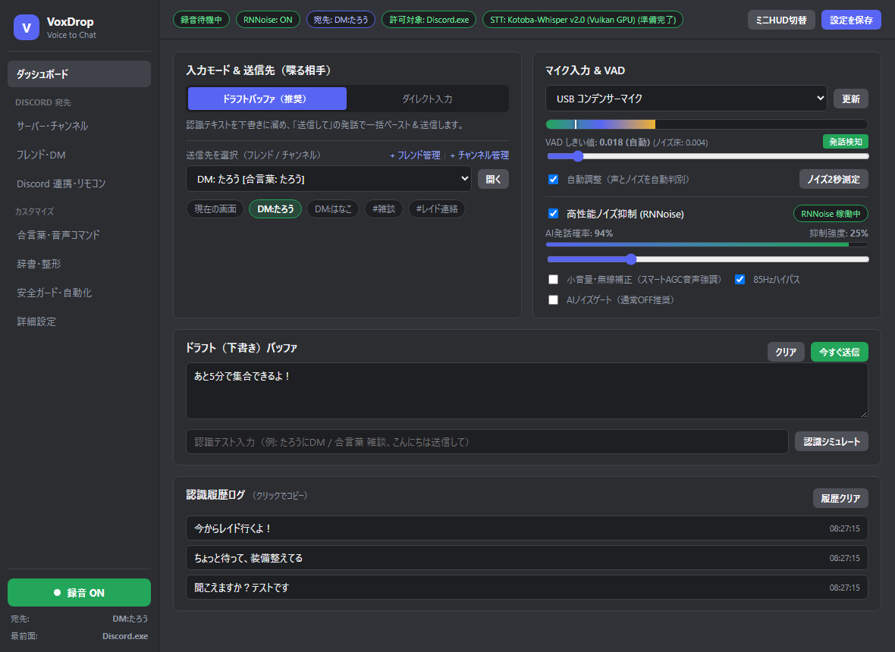
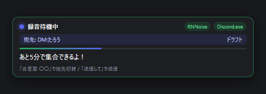

# VoxDrop — ハンズフリー日本語音声チャット支援アプリ（Discord 向け）

**VoxDrop** は、ゲームや作業をしながら **声だけで Discord のメッセージ入力・送信・宛先切替・リモコン操作** が完結する、Windows 向け超高速ローカル音声入力デスクトップアプリです。

すべて **ローカル推論（クラウド送信ゼロ・無料・オフライン動作）** ＆ **Windows 公式 API のみ（Discord 規約準拠・プロセス注入なし）** で安全に動作します。



---

## 主な特徴

### 1. 日本語特化 AI × Vulkan GPU 高速認識（約 0.5 秒）
- **Kotoba-Whisper v2.0（日本語 750 万件学習）**＋**Vulkan GPU 加速（AMD / NVIDIA / Intel 対応・CPU 自動フォールバック）** を内蔵。
- 英語誤爆ゼロ・早口や雑音環境にも強く、さらに **日本語自然化ポスト補正** により不自然な誤認識や記号崩れを自動整形します。
- 単一の **`voxdrop.exe`** にランタイム＆日本語モデルを丸ごと内蔵しているため、ダウンロードしてダブルクリックするだけですぐに使えます。

### 2. 声とノイズを自動判別する「適応型 VAD」＋ RNNoise ノイズ抑制
- **環境ノイズ自動学習**: 部屋の生活音・PC ファン・ゲーム音量をリアルタイムに学習し、VAD しきい値を自動追従。
- **喋り終わりピーク低下検知**: 自分の声のピーク音量からの低下を検知するため、環境音が大きくても発話終了を約 0.3 秒で即座に確定します。
- **2 秒ノイズ自動測定ボタン** ＆ **RNNoise リアルタイムノイズ抑制** ＆ **2ch オーディオインターフェース（Steinberg UR22mkII 等）片チャンネル自動ゲイン最適化** を搭載。

### 3. 声だけで宛先切替 → DM を開いて入力欄へ自動フォーカス＆即送信
- **合言葉・フレンド名で切り替え**: 「合言葉 〇〇」「〇〇にDM」「〇〇に切り替えて」と話すだけで、Discord を自動で前面化し、プロフィール画面を経由する場合も「メッセージ」ボタンを自動クリックしてチャット入力欄へフォーカスします。
- **複数候補の音声確認**: 似た名前のフレンドが複数いる場合は「この人で合っていますか？」と確認し、「はい」「違う・次」「前の人」「キャンセル」と声だけで選べます。
- **バックグラウンド自動送信＆復帰**: ゲーム画面のまま「送信して」「送って」「エンター」と言うだけで、裏にある Discord へ約 0.15 秒で自動送信し、元のゲーム画面へフォーカスを戻します（Webhook 直接送信にも対応）。

### 4. 見やすい宛先管理 & ゲーム画面に重ねられる透過ミニ HUD
- **サーバー・チャンネル / フレンド・DM / Discord 連携・リモコン** のわかりやすいタブ構成。
- クリップボードにコピーした Discord チャンネル／DM の URL を自動検知してワンクリック登録。
- **クリック透過・常時最前面ミニ HUD** で、ゲーム中でも認識状態や下書き（ドラフト）をひと目で確認できます。

| フレンド・DM 管理画面 | 透過ミニ HUD（オーバーレイ） |
| :---: | :---: |
|  |  |

---

## ダウンロード & 使い方（EXE 1 本で完結）

1. [Releases ページ](https://github.com/hhurt21/voxdrop/releases) から最新の **`voxdrop.exe`** をダウンロードします。
2. `voxdrop.exe` をダブルクリックして起動します（初回のみ内蔵ランタイム＆日本語モデルを `%LOCALAPPDATA%\VoxDrop\runtime\` へ自動展開します）。
3. ダッシュボード右側の **マイク入力** を選び、**「ノイズ2秒測定」** を押して 2 秒間静かに待ちます。
4. 左下の **「録音 ON」**（または `F8` キー）を押して、Discord へ向かって話しかけてください。

### よく使う音声コマンド（カスタマイズ可能）

| 話しかける言葉 | 動作 |
| :--- | :--- |
| `〇〇、送信して` / `送って` / `エンター` | テキストを Discord へ貼り付けて送信 |
| `合言葉 〇〇` / `〇〇にDM` / `〇〇に切り替えて` | 登録したフレンド DM・チャンネルへ切替＆入力欄フォーカス |
| `宛先解除` | 宛先固定を解除し、現在の Discord 画面へ送信 |
| `今の消して` / `キャンセル` | 下書き（ドラフト）を全消去 |
| `一つ戻して` | 直前のフレーズを取り消し |
| `改行して` | 改行（`Shift+Enter`）を挿入 |
| `ミュートして` / `認識再開` | 音声コマンドで認識を一時停止／再開 |
| `通話ミュート` / `次のチャンネル` / `未読へ` | Discord 公式ショートカットによるリモコン操作 |

---

## 安全性と Discord 規約への配慮

VoxDrop は **安全設計を最優先** しています：
- Discord プロセスへの DLL インジェクション・メモリ読み取り・クライアント改変は **一切行いません**。
- 個人アカウントトークン（セルフボット）は **一切使用しません**。
- 画面認識には Windows 公式アクセシビリティ API（UI Automation）、文字入力には OS 標準 `SendInput`、チャンネル移動には公式 `discord://` ディープリンクおよび公式 Webhook / Bot API のみを使用しています。
- 許可プロセスリスト（デフォルト: `Discord.exe` / `DiscordPTB.exe` / `DiscordCanary.exe`）による安全ガードを搭載し、クリップボード内容も送信後に自動で復元します。

---

## ソースからのビルド方法

- **動作環境**: Windows 10 / 11 (x64), Rust (`cargo`)
- **ビルド & テスト**:

```powershell
cargo test
cargo build --release --bins
```

スタンドアロン 1 本化 `.exe` を作成する場合：

```powershell
.\target\release\pack_standalone.exe `
  .\target\release\voxdrop.exe `
  .\voxdrop.exe `
  .\bin `
  .\models\ggml-kotoba-whisper-v2.0-q5_0.bin
```

---

## ライセンス

本プロジェクトは MIT License のもとで公開されています。内蔵・利用しているオープンソースモデルおよびランタイム（`whisper.cpp` / `Kotoba-Whisper v2.0` / `nnnoiseless` 等）は各プロジェクトのライセンスに従います。
