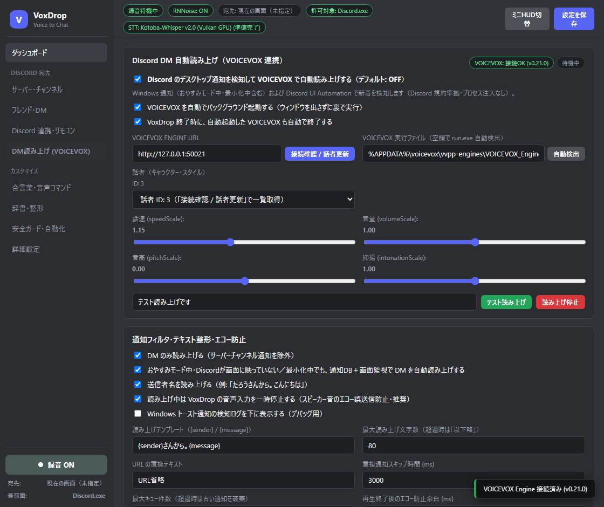
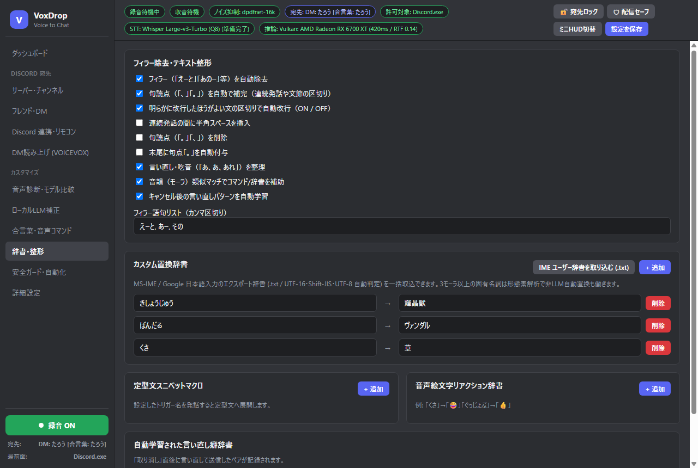
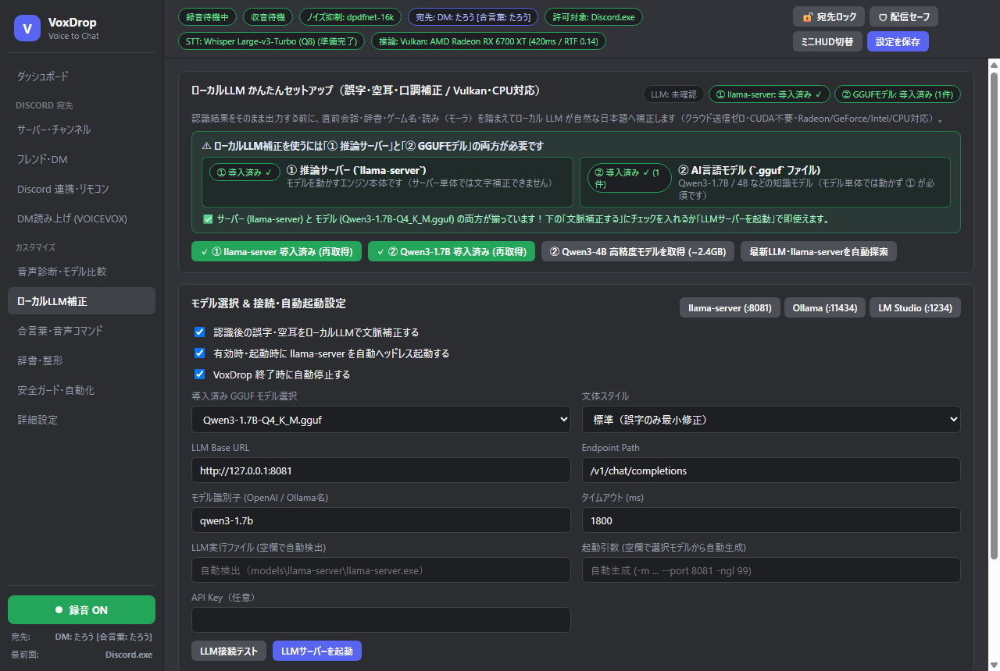

# VoxDrop — ハンズフリー日本語音声チャット支援アプリ（Discord 向け）

**VoxDrop** は、ゲームや作業をしながら **声だけで Discord のメッセージ入力・送信・宛先切替・リモコン操作** が完結する、Windows 向け超高速ローカル音声入力デスクトップアプリです。

すべて **ローカル推論（クラウド送信ゼロ・無料・オフライン動作）** ＆ **Windows 公式 API のみ（Discord 規約準拠・プロセス注入なし）** で安全に動作します。


---

## 主な特徴

### 1. 6層極限認識パイプライン × 非LLM音韻自動置換 × 全GPUベンダー対応（CUDA不要）
- **Whisper Large-v3-Turbo (Q8_0) 同梱・即時利用**: 単体実行ファイル **`voxdrop.exe`** にランタイム・日本語モデル・Silero VAD を内蔵し、起動するだけで即利用できます。
- **CUDA 不要のマルチGPU加速**: AMD Radeon / NVIDIA GeForce / Intel Arc / 内蔵GPU では **Vulkan (`whisper.cpp` / `llama-server`)** および **DirectML (`sherpa-onnx` Qwen3-ASR / DPDFNet / GTCRN / 3D-Speaker)** で高速推論し、非対応環境でも **CPU (AVX2/SSE)** へ自動フォールバックします。
- **v1.8.0 非LLM 高精度パイプライン**:
  - **形態素解析 (`Lindera` IPADIC) × 非LLM音韻辞書自動置換**: 辞書登録語句と入力文を全ひらがなモーラへ展開し、同音異字（例：`気象獣` → `輝晶獣`、3モーラ以上）を **ローカルLLMなし・数ms** で自動補正します。
  - **低信頼度トークン確率抽出 (`[?語句]`) & 形態素ROVER合議**: Whisper のトークン確信度を抽出し、2パス/2エンジン合議および LLM へ不安定箇所をピンポイント伝達します。
  - **個人会話 N-gram LM & 30秒短期文脈引き継ぎ**: 送信確定語彙をローカル `personal_ngram.json`（最大20,000語 LRU）に学習してリランキングに活用し、直近30秒の固有名詞を `initial_prompt` へ注入します（Discord宛先切替時に自動クリア）。
- **2系統 AI ノイズ抑制 + WASAPI AEC + 箱鳴り低減 + WSOLA**:
  - **VAD 判定側 (`GTCRN 16kHz` / `RNNoise`)** と **STT 推論側 (`DPDFNet2 16kHz / 48kHz`・残響ガード `attenuation_limit_db`)** に加え、**WASAPI ループバック参照 NLMS エコーキャンセル (AEC)**・**340Hz 箱鳴り低減 (Debox)**・**軽量 Dereverb** を搭載しています。


### 2. Silero VAD × 適応型ノイズ学習 ＋ 会話スタイルプリセット
- **Silero VAD (`silero_vad.onnx`) ＋ 適応型 SNR ＋ ストリーミング暫定プレビュー**: 話し始めの小声やゆっくり発話を取りこぼさず、長発話の途中経過をミニ HUD とドラフト欄へリアルタイム仮表示します。
- **会話プリセット & 15秒滑舌診断 & 夜間サイレント**: ダッシュボードの **「通常会話（推奨）」「早口・連続」「ゆっくり・小声」** に加え、マイク品質と話速を測って1クリック反映できる **15秒滑舌診断**、深夜時間帯の **自動夜間モード（高感度VAD＋VOICEVOX音量抑制＋Presence EQ強調）** を搭載。

### 3. 声だけで宛先切替 → DM を開いて入力欄へ自動フォーカス＆即送信
- **合言葉・フレンド名で切り替え**: 「合言葉 〇〇」「〇〇にDM」「〇〇に切り替えて」と話すだけで Discord を前面化し、プロフィール画面が開いた場合も「メッセージを送る」ボタンを自動押下してチャット入力欄へ確実にフォーカスします。
- **非ブロッキング複数候補の音声確認 & クイックDM返信**: 似た名前のフレンドが複数いる場合も確認バナーから「はい」「違う・次」「キャンセル」で選択でき、DM 読み上げ直後（60秒以内）なら「返信して 〇〇」だけで宛先切替なしで返信できます。
- **宛先ロック & 慎重チャンネル二重確認**: 音声誤認識で意図しない宛先へ切り替わるのを防ぐ **宛先ロック** と、誤爆したくない送信先に対する **カウントダウン強制ガード** を備えています。

### 4. 見やすい宛先管理 & ゲーム画面に重ねられる透過ミニ HUD
- **サーバー・チャンネル / フレンド・DM / Discord 連携・リモコン / DM読み上げ (VOICEVOX)** のわかりやすいタブ構成。
- クリップボードにコピーした Discord チャンネル／DM の URL を自動検知してワンクリック登録。
- **クリック透過・常時最前面ミニ HUD** で、ゲーム中でも認識状態や下書き（ドラフト）をひと目で確認できます。

| フレンド・DM 管理画面 | 透過ミニ HUD（オーバーレイ） |
| :---: | :---: |
|  |  |

---

### 5. Discord DM 自動読み上げ（VOICEVOX 窓なしバックグラウンド連携）
- **VOICEVOX 裏起動（コンソール／GUI 窓なし）**: `%APPDATA%\voicevox\...\run.exe` 等を自動検出し、画面を出さずにバックグラウンドで起動・終了できます（外部 TTS モデル非同梱）。
- **おやすみモード中・画面外・最小化中にも対応**: Windows 標準の通知 DB（`wpndatabase.db`）監視と Discord UI Automation 監視の併用により、おやすみモードでトーストが出ない状態や Discord が最小化／別ウィンドウの裏にある状態でも新着 DM を検知して読み上げます。
- **DM のみ厳密フィルタ＆エコー防止**: サーバーチャンネルやスレッド通知を除外して DM のみを読み上げ、VOICEVOX の再生中（および設定余白時間）は VoxDrop 側の音声認識を一時停止してスピーカー音のエコー誤送信を防ぎます。
- **自動デバイス切替追従**: 再生待機キューが空になるたび既定の Windows 出力デバイスへ再接続するため、ヘッドセットのスリープ復帰やデバイス変更後も音が途切れません。



---

### 6. 双方向 Discord リモコン（ON / 解除・戻る / 進む完全対応）
- **状態確認付きミュート / 解除**: 通話ミュート・スピーカーミュートは「ON」と「解除（戻す）」を分離し、Discord の UI Automation 状態を確認してから切り替えるため「既にミュート済みだったのに誤って解除してしまう」トグル事故を防ぎます。
- **全操作が可逆**: 画面戻る/進む (`Alt+←/→`)、チャンネル前後、未読チャンネル前後 (`Alt+Shift+↑/↓`)、最新メッセージへ戻る (`Shift+PgDn`)、直前編集 (`↑`) ⇄ 確定 (`Enter`)／編集キャンセル (`Esc`)、チャンネル検索 (`Ctrl+F`)、クイックスイッチャー (`Ctrl+K`)、ピン留め (`Ctrl+P`)、受信トレイ (`Ctrl+I`)、メンバー表示 (`Ctrl+U`) をボタンと声で操作できます。


---

### 7. アンチチート配慮の送信方式（`SendInput` 不使用 `PostMessage` 対応）
- 「安全ガード・自動化」タブから、環境に合わせて 4 種類の送信方式を選べます：
  - **標準 (`auto_paste`)**: `SendInput` による自動貼り付け＋送信。
  - **SendInput不使用 (`window_message`)**: `SendInput` やマウス移動を使わず、UIA フォーカス＋Win32 `PostMessageW` で Discord へ直接入力・送信（フォーカスできない場合は安全のためクリップボードコピーにフォールバック）。
  - **ゲーム中セーフ (`safe_when_game_active`)**: Discord 以外が最前面のときは `SendInput` を停止し、Webhook/Bot 送信またはクリップボードコピーに切替。
  - **完全セーフ (`no_send_input`)**: `SendInput`・マウス移動を一切使用しません。


---

### 8. 音声診断・A/Bモデル比較・3段階効果測定ベンチマーク＆認識統計 (v1.8.0)
- **推論デバイス・レイテンシ可視化**: アクティブな推論デバイス（`Vulkan: AMD Radeon RX 6700 XT` 等 / `DirectML` / `CPU`）と推論時間・RTF・話者声紋類似度をリアルタイム表示します。
- **3段階 補正効果自動ベンチマーク（生STT / 非LLM / ローカルLLM）**: 保存済みテストWAVに対し、① 生STT → ② 非LLM補正 → ③ ローカルLLM補正 の **CER (文字誤り率%)・完全一致率・処理時間・改善/改悪件数・3列カラー差分** を自動計測し、非LLM運用とLLM併用どちらが最適かアドバイスします。
- **音声再生 & A/B 再推論比較 & 自動パラメータ探索**: 直近 5 件の発話音声（16kHz PCM）を保持し、録音品質確認、別モデルでの **A/B 再推論比較**、**ワンクリック誤認識学習**、**AutoTuner（EQ / 340Hz Debox / WSOLA / Beam / DPDFNet dB の自動探索）** を行えます。
- **Push-to-Talk & 送信前カウントダウン & 宛先ロック・配信セーフモード**: `Mouse4`/`Mouse5` 押下中録音、送信待機中の音声/`Esc` キャンセル、慎重相手への二重確認、**宛先ロック**、履歴と送信先を即隠せる **配信セーフモード** に対応しています。


---

### 9. 統合モデルカタログ（✓ 導入済み可視化）・おまかせ推奨バンドル＆IME辞書・声紋フィルタ (v1.8.0)
- **「✓ 導入済み」の視認性強化 & 話者照合 (`3D-Speaker ONNX`) カテゴリ**: 導入済みモデルには緑枠＋ **`✓ 導入済み` / `✓ 使用中`** バッジを表示。詳細設定の「話者照合 (声紋)」から **`3D-Speaker ERes2Net Base` (~38MB)** を追加すれば、約5秒の声紋登録だけでゲーム音声や他人の声を自動除外できます（個別削除対応）。
- **DXGI GPU 自動診断ウィザード & おまかせ推奨バンドル & URL自己修復**: PCスペックに合う推奨構成の1クリック導入、GitHub/HuggingFace 自動探索・404自動復旧、ダウンロード完了時の自動プリセット適用＆ワンクリック Undo に対応しています。
- **MS-IME / Google 日本語入力 ユーザー辞書 `.txt` 一括取込**: 「辞書・整形」タブから UTF-8 / UTF-16LE / UTF-16BE / Shift-JIS の `.txt` エクスポート辞書を自動デコード・重複チェック付きで一括インポートできます。

| 詳細設定（導入済み表示・統合モデルカタログ） | 辞書・IME一括取込・スニペット・発音クセ学習 |
| :---: | :---: |
|  |  |

---

### 10. 専用「ローカルLLM補正」タブ（必須2ステップ可視化 & 空耳修正）(v1.8.0)
- **サーバーとモデルの両方が必要なことを2ステップで明示**: ローカルLLM補正を動かすには **① 推論サーバー本体（`llama-server`）** と **② AI言語モデル（`Qwen3-1.7B` / `4B` 等の `.gguf`）** の**両方**が必須です（片方だけでは動作しません）。タブ上部のチェックリストとボタン色が **`✓ ① llama-server 導入済み`** / **`✓ ② GGUFモデル 導入済み`** へ自動変化し、何が不足しているか一目でわかります。
- **外部サーバー連携 & GGUF 自動起動 & ライブ補正テスト**: 外部の **Ollama (`:11434`)** / **LM Studio (`:1234`)** を利用する場合は ①② の導入不要で接続プリセットから即切替可能です。`llama-server` を使う場合は導入済み `.gguf` を選ぶだけで起動引数を自動生成し、画面下部のライブ補正テストで即座に効果を確認できます。



---

## ダウンロード & 使い方（EXE 1 本で完結）

1. [Releases ページ](https://github.com/hhurt21/voxdrop/releases) から最新の **`voxdrop.exe`** をダウンロードします。
2. `voxdrop.exe` をダブルクリックして起動します（初回のみ内蔵ランタイム＆日本語モデルを `%LOCALAPPDATA%\VoxDrop\runtime\` へ自動展開します）。
3. ダッシュボード右側の **マイク入力** を選び、**「ノイズ2秒測定」** を押して 2 秒間静かに待ちます。
4. 左下の **「録音 ON」**（または `F8` キー）を押して、Discord へ向かって話しかけてください。

### よく使う音声コマンド（チップ形式で 1 語ずつ簡単カスタマイズ）

「合言葉・音声コマンド」タブからカンマ区切りなしで 1 語ずつ追加（`＋ 追加` / Enter）および削除（`×`）ができます。


| 話しかける言葉 | 動作 |
| :--- | :--- |
| `〇〇、送信して` / `送って` / `エンター` | テキストを Discord へ貼り付けて送信（1950文字超は自動分割） |
| `合言葉 〇〇` / `〇〇にDM` / `〇〇に切り替えて` | 登録したフレンド DM・チャンネルへ切替＆入力欄フォーカス |
| `返信して 〇〇` | 直近の DM 読み上げ相手へ宛先切替なしで即返信 |
| `〇〇を△△に変えて` | 直前の発話・下書きの誤認識語だけをピンポイント修正 |
| `ネタバレ 〇〇` / `強調` / `コード` / `引用` | Discord Markdown (`||〇〇||` / `**〇〇**` / `` `〇〇` `` / `> 〇〇`) に装飾 |
| `クリップボード貼って` / `URL送って` | クリップボードの内容やコピーした URL を貼り付け・送信 |
| `宛先ロック` / `宛先ロック解除` | 音声や自動検出による宛先変更をロック／解除 |
| `宛先解除` | 宛先固定を解除し、現在の Discord 画面へ送信 |
| `今の消して` / `キャンセル` | 下書き（ドラフト）を全消去 |
| `一つ戻して` | 直前のフレーズを取り消し |
| `改行して` | 改行（`Shift+Enter`）を挿入 |
| `ミュートして` / `認識再開` | 音声コマンドで認識を一時停止／再開 |
| `通話ミュート` / `ミュート解除` | マイクミュートの ON / 解除（戻す） |
| `スピーカーミュート` / `スピーカー解除` | スピーカーミュート（デフン）の ON / 解除 |
| `前の画面` / `次の画面` | チャンネル・DM 履歴を戻る / 進む（`Alt+←/→`） |
| `前の未読` / `次の未読` / `最新へ` | 未読チャンネル移動・最新メッセージへ戻る |
| `直前を編集` / `編集キャンセル` | 直前発言の編集開始・編集や検索のキャンセル（`Esc`） |

---

## 安全性と Discord 規約への配慮

VoxDrop は **安全設計を最優先** しています：
- Discord プロセスへの DLL インジェクション・メモリ読み取り・クライアント改変は **一切行いません**。
- 個人アカウントトークン（セルフボット）は **一切使用しません**。
- 画面認識には Windows 公式アクセシビリティ API（UI Automation）、文字入力には OS 標準 `SendInput`、チャンネル移動には公式 `discord://` ディープリンクおよび公式 Webhook / Bot API のみを使用しています。
- 許可プロセスリスト（デフォルト: `Discord.exe` / `DiscordPTB.exe` / `DiscordCanary.exe`）による安全ガードを搭載し、クリップボード内容も送信後に自動で復元します。

---

## ソースからのビルド方法

- **動作環境**: Windows 10 / 11 (x64), Rust (`cargo`)
- **ビルド & テスト**:

```powershell
cargo test
cargo build --release --bins
```

スタンドアロン 1 本化 `.exe` を作成する場合：

```powershell
.\target\release\pack_standalone.exe `
  .\target\release\voxdrop.exe `
  .\voxdrop.exe `
  .\bin `
  .\models\ggml-large-v3-turbo-q8_0.bin
```

---

## 免責事項・利用上の注意

- **非公式ツール**: VoxDrop は個人の開発による非公式の音声入力支援ツールであり、Discord Inc. およびその他のサービス・企業とは一切関係ありません。
- **動作方式と安全性**: 本アプリは Windows 標準の公式 API（UI Automation・入力 API・クリップボード等）のみを使用しており、Discord クライアントの改変、プロセス注入、User Token の取得・利用（Self-bot 行為）は一切行いません。常にユーザー自身の音声発話を起点として動作します。
- **ゲームとの同時利用について**: 本アプリはグローバルホットキーおよび OS レベルの仮想キー入力を使用します。アンチチートシステムを搭載したゲームと同時に起動した場合、環境によっては入力のブロックや誤検知が発生する可能性があります。ご利用は各ゲームおよびサービスの利用規約を確認のうえ、自己責任でお願いいたします。
- **VOICEVOX 連携について（導入時）**: 読み上げ機能を利用する場合は、別途ユーザーご自身の環境にインストール・起動したローカルの VOICEVOX ENGINE と通信します。VoxDrop 本体に音声モデル・音声データは同梱していません。生成された音声を配信・動画・公開コンテンツ等で利用する場合は、VOICEVOX 本体および使用キャラクターごとの利用規約・クレジット表記ルールに従ってください。

## サードパーティライセンス

VoxDrop に同梱・利用しているモデルおよびオープンソースソフトウェアのライセンス・著作権表記については、[THIRD_PARTY_LICENSES.md](./THIRD_PARTY_LICENSES.md) をご参照ください。

---

## ライセンス

本プロジェクトは MIT License のもとで公開されています。内蔵・利用しているオープンソースモデルおよびランタイム（`Whisper Large-v3-Turbo` / `whisper.cpp` / `Silero VAD` / `Kotoba-Whisper v2.0` / `nnnoiseless` 等）は各プロジェクトのライセンスに従います。
